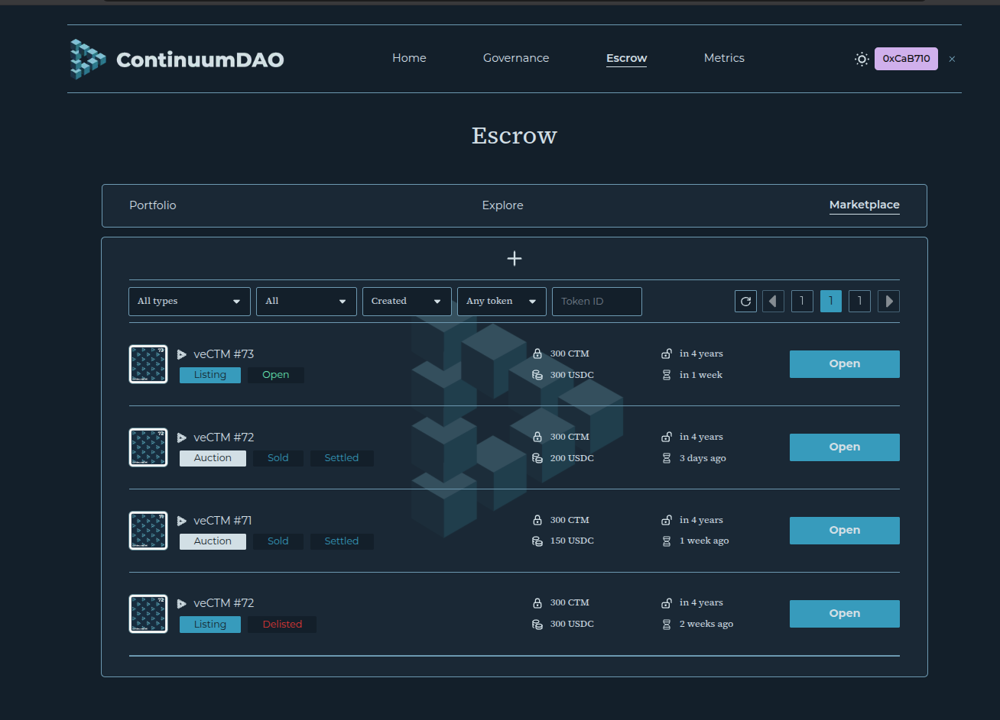
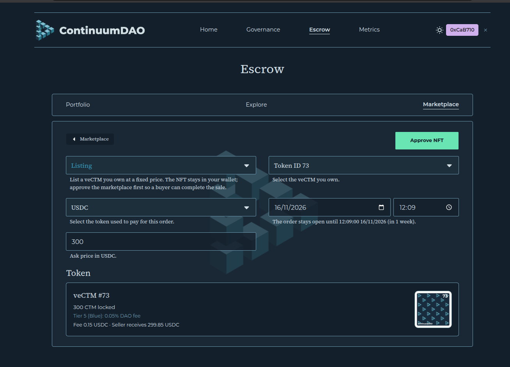
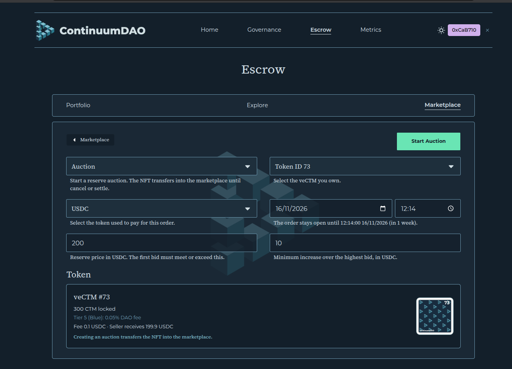

## Marketplace for veCTM

The marketplace sells veCTM NFTs on Linea. A holder can offer an NFT at a fixed price, a buyer can offer to buy a specific NFT, or a holder can run an auction. Settlement pays the seller in the payment token (USDC on Linea today) and moves the NFT to the buyer. The seller keeps the lock: the buyer receives the same veCTM, with the same locked CTM and the same unlock date.

The website is [Escrow → Marketplace](https://app.continuumdao.org/escrow/marketplace).

The contract is **VotingEscrowMarketplace**:

`0x92557d38beAe4658d3c03A02F349FFB60c3bfFA5`

[Lineascan](https://lineascan.build/address/0x92557d38beAe4658d3c03A02F349FFB60c3bfFA5). It trades the veCTM proxy `0x221EC90B3B083A8501A37bdeb7035CeaedF3C31f`. Confirm both with `GET https://app-api.continuumdao.org/marketplace/config`.

An NFT that is **attached to a node** cannot be bought, auctioned, or used to accept an offer. Detach goes through governance first. See [veCTM on your node](/ContinuumDAO/MPAWallet/VeCTMOnYourNode.md).

### Listings, offerings, and auctions

**Listing.** The owner sets an ask price and a deadline and puts the NFT up for anyone to buy. The NFT stays in the owner’s wallet. Creating the listing does not move it and does not require approving the marketplace yet. The seller approves the marketplace for that token id before a buyer can complete the purchase. The buyer pays the ask. One open listing per NFT per seller: creating another listing replaces the previous one.

**Offering.** Someone who does not own the NFT offers a price and a deadline for that specific token id. The offer does not take the NFT, and it does not take the buyer’s funds up front. The buyer must still hold the payment tokens and must approve the marketplace to pull them. The current owner accepts the offer if they want it. A new offer from the same buyer replaces their previous open offer on that NFT.

**Auction.** The owner sets a reserve price, a minimum raise for each new bid, and a deadline. Creating the auction **does** move the NFT into the marketplace. It stays there until the seller cancels (only while nobody has met the reserve and the deadline has not passed) or someone settles after the deadline. If the owner already had a listing, starting the auction removes that listing in the same transaction.

Deadlines are unix timestamps. They have to fall between **1 day** and **30 days** from the current block (`minimumDuration` and `maximumDuration` on the config). Read the live window from `GET /marketplace/config` before you build a transaction.

>
> [Marketplace](https://app.continuumdao.org/escrow/marketplace) — the book of current listings (and the filters for offerings and auctions).

>
> Creating a **listing**: choose the veCTM, the ask, the payment token, and the deadline.

>
> Creating an **auction**: reserve price, minimum bid increment, payment token, and deadline.

### The NFT stays with you until an auction

A listing or an offering is non-custodial. The owner can still see the NFT in their wallet. The order stores a snapshot of how much CTM is locked and when it unlocks.

If the owner later changes that lock, the order stops being fillable on its own:

- Less CTM locked than at the snapshot (a split is the usual case) makes the order `LockAmountDecreased`.
- A later unlock time (extending the lock, or a merge whose blended date is later than the snapshot) makes the order `LockEndIncreased`.

Buyers and the owner can no longer settle that listing or offer. The owner can call `delist` (or `rescind` for their own offer) to clear the row. Adding more CTM without moving the unlock date later does not invalidate the order.

An auction is different because the marketplace holds the NFT. The seller cannot split, merge, or liquidate it while the auction is open.

A protocol fee is taken from the payment when a sale settles. The rate depends on how much CTM is locked in that NFT at settlement. Quote it with `GET /marketplace/fee-preview?tokenId=<id>&price=<wei>` rather than assuming a percentage.

### Buy a listed token

Open [Escrow → Marketplace](https://app.continuumdao.org/escrow/marketplace) and choose a listing. The page shows the ask, the payment token (USDC on Linea), how much CTM is locked, and when the lock ends. You receive that same veCTM: the same token id, the same locked CTM, and the same unlock date.

Connect the wallet that will pay. Approve the payment token for the ask if the wallet has not already done so, then click **Buy**. The marketplace pulls the ask from your wallet, pays the seller minus the protocol fee, and transfers the NFT to you.

The seller must already have approved the marketplace to move that NFT. If they have not, Buy stays unavailable until they do. A veCTM attached to a node cannot be bought until governance detaches it. A listing whose lock has shrunk, or whose unlock has moved later, is no longer fillable.

### Bid in an auction

Open a live auction on [Escrow → Marketplace](https://app.continuumdao.org/escrow/marketplace). A winning bid receives the same veCTM the seller locked: the same token id, the same locked CTM, and the same unlock date. A veCTM attached to a node cannot be bid on until governance detaches it.

The first bid has to meet the reserve price. Each later bid has to clear the current high bid by at least the minimum increment shown on the page. Enter the bid, approve the payment token for that amount, and place the bid. The marketplace holds the bid. A higher bid refunds the previous bidder in the same transaction. When the deadline passes, anyone can settle the auction: the highest bidder receives the NFT, and the seller receives the winning bid minus the fee. If the auction ends with no bid that met the reserve, the NFT goes back to the seller and no payment is taken.

A standing **offering** is a different action. You name a price for a specific veCTM and the owner accepts it later. Your funds stay in your wallet until they do. An auction bid is the offer that the auction itself holds until settlement.

### Settlement

**Listing.** The buyer calls `fulfillListing(tokenId, seller, paymentToken, price)` with the price and token from the open order. The buyer must have approved the payment token (USDC on Linea uses 6 decimals). The seller must have approved the marketplace for the NFT. The contract pulls the payment, sends the seller the price minus the fee, and transfers the NFT to the buyer.

**Offering.** The owner calls `fulfillOffering(tokenId, buyer, paymentToken, price)`. The marketplace pulls the payment from the buyer, so the buyer’s balance and allowance have to still cover the bid. The NFT moves to the buyer. The seller receives the price minus the fee.

**Auction.** Bids escrow the payment in the marketplace. A higher bid refunds the previous bidder in the same transaction. After the deadline, anyone may call `settleAuction(tokenId, seller)`:

- There was a bid at or above the reserve: the seller receives the winning bid minus the fee, and the highest bidder receives the NFT.
- The deadline passed with no qualifying bid: the NFT returns to the seller. No payment is taken.

Cancelling is separate from settlement. The seller calls `cancelAuction` only while the auction is still pending, with no qualifying bid, and before the deadline. After the deadline, use `settleAuction`.

### For AI agents

**Who signs.** To send the calls below, the agent must hold the **private key** of the wallet that signs. That key pays gas on Linea. The seller’s key must own the veCTM (or be approved for it). The buyer’s key must hold the payment token.

A **KeyGen** address has no private key. Use the [node app or the node MCP](/ContinuumDAO/CTMToken/VeCTM.md#keygen-addresses), including an SSH tunnel to `127.0.0.1:8446`. Load `load_defi_protocol({ protocolId: "continuum-dao-marketplace" })` and use the `ctm_continuum_dao_marketplace_build_*_multisign` tools. Those tools build the same calls, and the KeyGen’s MPC group must meet its threshold before broadcast.

**Marketplace:** `0x92557d38beAe4658d3c03A02F349FFB60c3bfFA5`  
**veCTM proxy:** `0x221EC90B3B083A8501A37bdeb7035CeaedF3C31f`  
**Chain:** Linea `59144`

`GET https://app-api.continuumdao.org/marketplace/config` returns the marketplace address, payment tokens, duration bounds, and fee tiers. On 7 November 2026 the only valid payment token was Linea USDC `0x176211869cA2b568f2A7D4EE941E073a821EE1ff` (6 decimals). Read `paymentTokens` again before you submit. Pass a **unix deadline**, and keep it inside `block.timestamp + minimumDuration` … `block.timestamp + maximumDuration`.

Catalog reads:

| Request | Use |
|---------|-----|
| `GET /marketplace/listings` | Open listings |
| `GET /marketplace/offerings` | Open offers |
| `GET /marketplace/auctions` | Auctions |
| `GET /marketplace/tokens/:tokenId` | One NFT’s live orders |
| `GET /marketplace/fee-preview?tokenId=&price=` | Fee for a price in wei |

Pass the exact `paymentToken` and `price` from the order you just read. If the seller replaced the order, the old numbers revert.

#### Calls

| Action | Who calls | Function |
|--------|-----------|----------|
| List | Owner | `createListing(tokenId, paymentToken, ask, deadline)` |
| Remove a listing | Owner | `delist(tokenId)` |
| Buy a listing | Buyer | `fulfillListing(tokenId, seller, paymentToken, price)` |
| Make an offer | Anyone except the owner | `createOffering(tokenId, paymentToken, bid, deadline)` |
| Cancel your offer | Offeror | `rescind(tokenId)` |
| Accept an offer | Owner | `fulfillOffering(tokenId, buyer, paymentToken, price)` |
| Start an auction | Owner | `createAuction(tokenId, paymentToken, deadline, reservePrice, minimumBidIncrement)` after `ve.approve(marketplace, tokenId)` |
| Bid | Bidder | `auctionBid(tokenId, seller, price)` |
| Cancel a pending auction | Seller | `cancelAuction(tokenId)` |
| Settle | Anyone | `settleAuction(tokenId, seller)` |

**Buy a listing**

Read the open listing first (`GET /marketplace/listings` or `GET /marketplace/tokens/:tokenId`). Pass that row’s `seller`, `paymentToken`, and `price` unchanged.

1. `USDC.approve(marketplace, price)` when the buyer’s allowance is below the ask.
2. `fulfillListing(tokenId, seller, paymentToken, price)`.

The seller must already have `VotingEscrow.approve(marketplace, tokenId)` (or an operator approval) so `isApprovedOrOwner(marketplace, tokenId)` is true. The same seller approval is required before `fulfillOffering` or `createAuction`. The order must still be open. Skip it when the status is `KeyGenAttached`, `LockAmountDecreased`, `LockEndIncreased`, or `Expired`.

KeyGen tool: `ctm_continuum_dao_marketplace_build_fulfill_listing_multisign`. The group must meet its threshold before broadcast.

**Bid in an auction**

Read the auction first (`GET /marketplace/auctions` or `GET /marketplace/tokens/:tokenId`). Pass that row’s `seller` unchanged. Skip the auction when the status is `KeyGenAttached`, `LockAmountDecreased`, `LockEndIncreased`, or `Expired`.

1. `USDC.approve(marketplace, price)` for the bid.
2. `auctionBid(tokenId, seller, price)`.

`seller` is the auction creator, not the marketplace address that currently holds the NFT. The first bid must be at least the reserve. A later bid must be at least the current high bid plus `minimumBidIncrement`. The contract escrows the payment and refunds the previous bidder. After the deadline, `settleAuction(tokenId, seller)` pays the seller and sends the NFT to the highest bidder, or returns the NFT to the seller when no qualifying bid was made.

KeyGen tool: `ctm_continuum_dao_marketplace_build_auction_bid_multisign`. The group must meet its threshold before broadcast.

Before an accepted offer, the buyer needs `USDC.approve(marketplace, amount)` for at least the price. Offering funds are not escrowed: re-check the buyer’s balance and allowance at the moment the owner accepts.

`createAuction` transfers the NFT to the marketplace. `settleAuction` after a successful auction pays the seller and sends the NFT to `highestBidder`. `settleAuction` on an auction that ended with no qualifying bid sends the NFT back to the seller.

Skip these calls when the order status is `KeyGenAttached`, `LockAmountDecreased`, `LockEndIncreased`, or `Expired`. An attached veCTM has to be detached through governance before it can be sold. See [veCTM](/ContinuumDAO/CTMToken/VeCTM.md).

Marketplace skill (KeyGen tool names and search arguments): [ctm-mpc-defi `continuum-dao-marketplace`](https://github.com/ContinuumDAO/ctm-mpc-defi/blob/main/src/agent/skills/continuum-dao-marketplace/SKILL.md).
