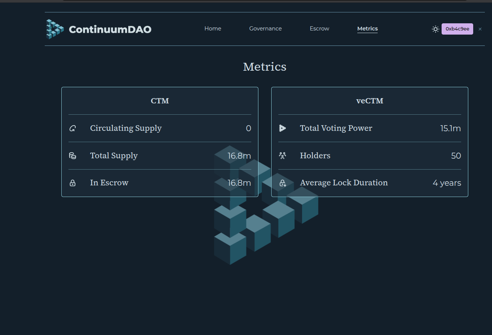
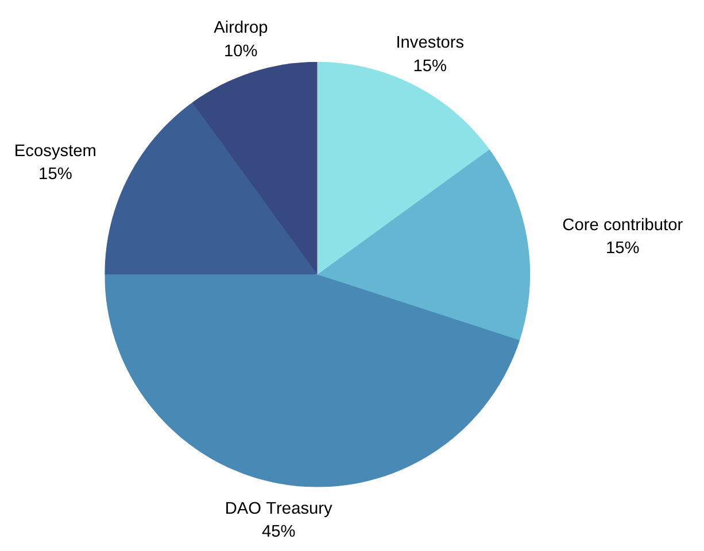

## Tokenomics

**CTM** is ContinuumDAO’s token. The contract is **`CTM`**, which extends **`CTMERC20`**: an ERC-20 with native cross-chain transfer through [C3Caller](/ContinuumDAO/C3Caller/Overview.md). A cross-chain send burns CTM on the source chain and asks the peer contract on the destination chain to mint the same amount. If the destination call fails, the source chain mints the burned amount back to the sender. The mechanism is the same pattern described in the [CTMERC20 demo](/ContinuumDAO/C3Caller/C3CallerDemo.md). C3Caller message passing itself is still in final testing; see [Contract addresses](/ContinuumDAO/C3Caller/ContractAddresses.md).

New CTM is minted on **Ethereum**, and only by governance. That Ethereum contract is the home instance: its **`globalSupply()`** is the supply that exists across every chain, and **`maxSupply()`** is the mint cap. **Linea** has its own CTM deployment. The DAO, the governor, and veCTM all live on Linea. The same CTM address is used on both chains:

`0x7581696b0ED142f6534E5797baaABBb9a1b27086`

On Linea the ERC-20 **`totalSupply()`** is only the CTM sitting on Linea. It is a different number from **`globalSupply()`** on Ethereum whenever some CTM remains on another chain.

Code: [vectm `CTM.sol`](https://github.com/ContinuumDAO/vectm/blob/main/src/token/ctm/CTM.sol) and [`CTMMintable.sol`](https://github.com/ContinuumDAO/vectm/blob/main/src/token/ctm/CTMMintable.sol).

### Supply

| Figure | What it is |
|--------|------------|
| **Maximum supply** | **100 million CTM.** Governance cannot mint past `maxSupply` on the Ethereum home contract. |
| **Global supply** | `globalSupply()` on Ethereum. Every mint and burn on the home contract updates it. A cross-chain transfer moves CTM between chains and leaves global supply unchanged. |
| **In escrow** | CTM held by the veCTM contract on Linea. That is the supply locked in voting-escrow NFTs. |
| **Circulating supply** | Global supply, minus CTM in the veCTM contract, minus CTM in the current Linea treasury. Liquid CTM in other wallets counts as circulating. |

The [Metrics](https://app.continuumdao.org/metrics) page is the live view of those figures, plus veCTM voting power, the number of veCTM holders, and the average lock duration. The app reads `GET /metrics` and labels the API field `totalSupply` as **Total Supply**. That field is **global supply**, not the Linea ERC-20 `totalSupply()`.

>
> [Metrics](https://app.continuumdao.org/metrics): circulating supply, total supply (global supply), and CTM in escrow, next to veCTM total voting power, holders, and average lock duration.

A connected wallet’s own locks are on [Escrow](https://app.continuumdao.org/escrow). Each NFT shows the CTM locked inside it, the unlock time, and its voting power.

> **Screenshot placeholder:** `_media/ctm-escrow-wallet.png`
>
> [Escrow](https://app.continuumdao.org/escrow) with a wallet connected: that wallet’s veCTM positions.

**Snapshot from the API on 7 November 2026.** These numbers move. Use the Metrics page for the current ones.

| Metric | Value |
|--------|--------|
| Global supply (`totalSupply`) | 16,795,423.14 CTM |
| In escrow | 16,795,423.14 CTM |
| Circulating supply | 0 CTM |
| Total voting power | 15,059,542.63 |
| veCTM holders | 50 |
| Average lock | about 4 years (1,456 days) |

At that reading, every CTM in the global supply was locked in veCTM, so circulating supply was zero.

### Allocation

The mint cap is allocated as follows. The chart and the longer treasury narrative are also in the [White Paper — Tokenomics](/ContinuumDAO/WhitePaper.md#tokenomics).

- **DAO Treasury — 45%.** Spending is decided by on-chain veCTM votes. The treasury may fund projects, pay for services, or hold tokens the DAO acquires, within the Mission and Vision in the [Constitution](/ContinuumDAO/Governance/Constitution.md).
- **Ecosystem — 15%.** Terms are decided by DAO vote. 5% is for chain partners, 5% for project partners, and 5% for incubation incentives.
- **Core contributors — 15%.** 13% is for early core contributors, shared as veCTM with voting rights. 2% is for future core contributors.
- **Airdrop — 10%.** For the early community that supported ContinuumDAO in 2023. The airdrop is CTM vested into veCTM NFTs with a four-year lock and full voting rights. Community members claim these NFTs on Linea.
- **Investors — 15%.** Reserved for venture allocations. Any terms are decided by a DAO vote.

Locking CTM into veCTM, attaching it to a node, and trading the NFT are covered in [veCTM](/ContinuumDAO/CTMToken/VeCTM.md) and the [veCTM marketplace](/ContinuumDAO/CTMToken/Marketplace.md).

### For AI agents

**Audience:** agents that need supply, addresses, or a wallet’s locks. The reads below are public HTTP. They do not require a wallet or a private key.

Writes are different. Creating a lock, adding CTM, extending its unlock time, withdrawing after expiry, splitting, merging, liquidating, or trading on the marketplace requires the **private key** of the signing wallet. A node **KeyGen** has no private key: the MPC group must meet its threshold instead. See [veCTM — For AI agents](/ContinuumDAO/CTMToken/VeCTM.md#for-ai-agents).

Base URL: `https://app-api.continuumdao.org`

The website proxies the same routes under `https://app.continuumdao.org/api/backend/…`. Call the API host directly.

#### Supply and addresses

| Request | Returns |
|---------|---------|
| `GET /metrics` | `escrowed`, `totalSupply`, `circulatingSupply`, `totalPower`, `holders`, `avgLockDuration`. All amounts are decimal wei strings (18 decimals), except `holders` (count) and `avgLockDuration` (seconds). **`totalSupply` is `globalSupply()`**, not Linea `totalSupply()`. |
| `GET /protocol/ctm` | `{ "address": "0x…" }` — CTM on Linea |
| `GET /protocol/ve` | VotingEscrow **proxy** on Linea |
| `GET /protocol/dao` | Linea governor |
| `GET /protocol/dist` | Distribution contract, when deployed |
| `GET /protocol/networks` | Networks the app knows, with chain id and C3Governor |

On-chain, read `globalSupply()` and `maxSupply()` on the **Ethereum** CTM contract (`chainId` 1, same address as above). Read Linea `totalSupply()` and `balanceOf(votingEscrow)` on **Linea** (`chainId` 59144) when you need that chain’s balance. Prefer `GET /metrics` for the published circulating and escrow figures so you use the same treasury subtraction the website uses: circulating = global supply − veCTM CTM balance − current Linea treasury CTM balance.

#### A wallet’s veCTM

| Request | Returns |
|---------|---------|
| `GET /user/:address` | That wallet’s delegate and its veCTM rows: `id`, `locked`, `end`, `votes` |
| `GET /tokens?ids=1,2,3` | Lock and vote data for those token ids |
| `GET /tokens?page=N` | Up to 16 veNFTs per page (`page` 0 is the newest) |

`locked`, `end`, and `votes` are wei / unix-seconds strings. NFT art is `GET /:id/image`. Metadata is `GET /:id`.

#### Node MCP

On an MPA node, the catalog server **`continuumdao-tokenomics`** (`/mcp/continuumdao-tokenomics`) wraps this API. Load it with `resolve_catalog_mcp_enablement({ toolset: "continuumdao-tokenomics" })`, then `agent_load_mcp_server({ serverId: "continuumdao-tokenomics" })`. Tools are prefixed `continuumdao-tokenomics__`.

| Tool | Use |
|------|-----|
| `get_ctm_metrics` | The `/metrics` fields |
| `get_ctm_protocol_addresses` | Protocol addresses plus explorer links |
| `get_ctm_tokenomics_snapshot` | Metrics, addresses, and a short allocation note |
| `get_ve_ctm_position` | One wallet’s veNFTs, locked CTM, voting power, delegate, last vote |
| `get_ve_ctm_tokens` | Paginated veNFTs |
| `get_ve_ctm_locked_for_addresses` | Locked CTM for a list of holder addresses |

The maximum supply of 100 million CTM is documented here. `/metrics` does not return it. Read `maxSupply()` on Ethereum CTM when you need the cap from chain state.

Lock, split, merge, and marketplace writes are in [veCTM — For AI agents](/ContinuumDAO/CTMToken/VeCTM.md#for-ai-agents) and [Marketplace — For AI agents](/ContinuumDAO/CTMToken/Marketplace.md#for-ai-agents).
