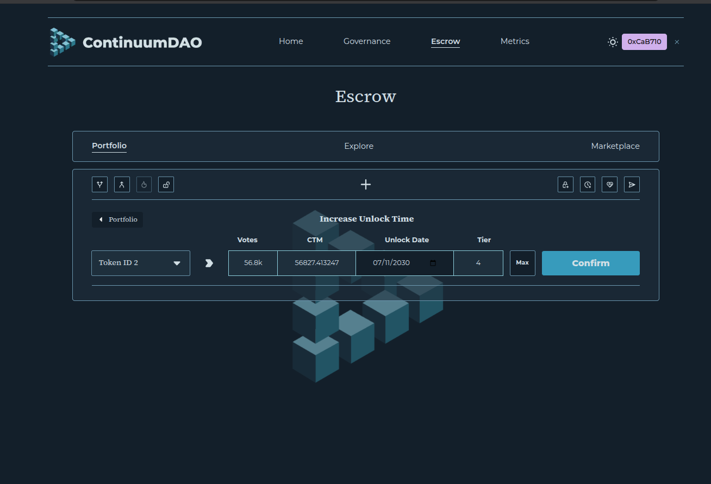
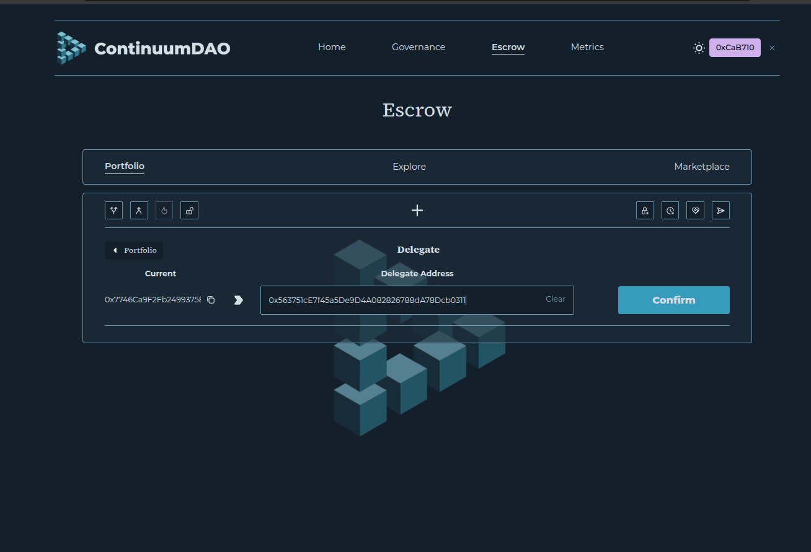
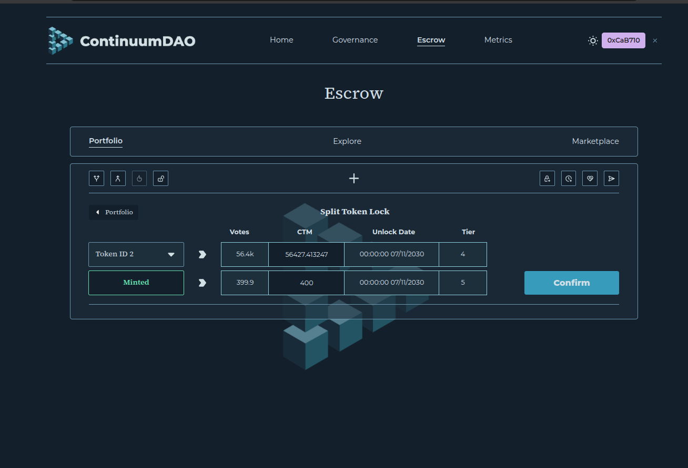
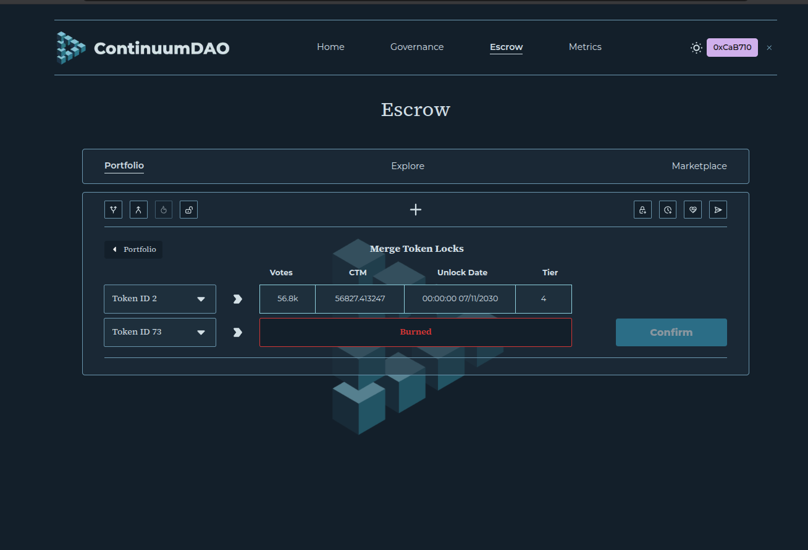

## veCTM

**veCTM** is a voting-escrow NFT. You lock **CTM** for a period you choose, up to four years, and the lock becomes an NFT. The NFT’s voting power starts from how much CTM is inside it and how long is left on the lock, then declines toward zero as the unlock date gets closer. A lock of the same size held for longer has more voting power today.

That voting power is what ContinuumDAO governance counts. Holders use it to propose and vote. An operator can also attach one veCTM to an MPA Wallet node. While it is attached, that node can qualify for free wallet signatures and Private VPN, and the NFT stays on the node until governance agrees to release it. Attaching is described in [veCTM on your node](/ContinuumDAO/MPAWallet/VeCTMOnYourNode.md).

veCTM exists on **Linea** (chain id **59144**). The contract to call is the **VotingEscrow proxy**:

`0x221EC90B3B083A8501A37bdeb7035CeaedF3C31f`

[Lineascan](https://lineascan.build/address/0x221EC90B3B083A8501A37bdeb7035CeaedF3C31f). The proxy is upgradeable (UUPS). Always call this address. The logic contract behind it can change.

The website for locks is [Escrow](https://app.continuumdao.org/escrow). Code: [vectm `VotingEscrow.sol`](https://github.com/ContinuumDAO/vectm/blob/main/src/token/VotingEscrow.sol).

To buy a listed veCTM, or to bid in an auction for one, use the [marketplace](/ContinuumDAO/CTMToken/Marketplace.md).

### Create a lock

On Escrow, connect the wallet that holds CTM, approve the VotingEscrow contract to spend that CTM, and create a lock. You choose the amount and the duration. The contract rounds the unlock time down to a week boundary. The shortest practical lock is one week. The longest is four years (208 weeks). Each new lock must be at least the on-chain minimum, which is 1 CTM unless governance has changed `minimumLock`.

The new NFT is minted to the wallet that calls `create_lock`. To mint it straight to someone else, the wallet that pays the CTM calls `create_lock_for` with that recipient.

Adding CTM and extending the unlock date stay available while a veCTM is attached to a node. Transfer, split, merge, liquidate, and withdraw wait until governance detaches it.

### Increase unlock time

**Increase Unlock Time** keeps the same NFT and the same locked CTM, and moves the unlock date further out. Voting power rises because more time is left on the lock. The new date has to be later than the current unlock, and it cannot be more than four years from today. The contract rounds the date down to a week boundary (Thursday 00:00 UTC).

On [Escrow](https://app.continuumdao.org/escrow), open **Increase Unlock Time**, select the veCTM, and pick the new unlock date. This action does not pull extra CTM from the wallet.

An expired lock cannot be extended. Withdraw it, or create a new lock.

If that veCTM has an open marketplace listing or offer, a later unlock date makes the order unfillable (`LockEndIncreased`). See [Marketplace](/ContinuumDAO/CTMToken/Marketplace.md).

> [Escrow](https://app.continuumdao.org/escrow) — **Increase Unlock Time** panel, with a veCTM selected and a later unlock date.

### Increase amount

**Increase Amount** adds more CTM to a veCTM you already hold. The unlock date stays the same. Voting power rises because more CTM is locked for the time that remains.

On [Escrow](https://app.continuumdao.org/escrow), open **Increase Amount**, select the veCTM, and enter the extra CTM. The wallet approves VotingEscrow for that amount, then the contract pulls it into the existing NFT. The amount has to be greater than zero, and the lock has to still be active. An expired lock cannot take more CTM. Withdraw it, or create a new lock.

This still works while the NFT is attached to a node. Adding CTM leaves an open marketplace listing or offer fillable, because the locked amount has gone up and the unlock date has not moved later. See [Marketplace](/ContinuumDAO/CTMToken/Marketplace.md).

### Withdraw

**Withdraw** is how a finished lock becomes CTM again. After the unlock time has passed, open **Withdraw** on [Escrow](https://app.continuumdao.org/escrow), select that veCTM, and confirm. The contract sends the full locked CTM back to the owner and burns the NFT. There is no penalty.

Withdraw is available only once `locked.end` is in the past. Before that date, the early exit is [Liquidate](#split-merge-and-liquidate). Withdraw also waits until governance detaches the NFT if it is attached to a node.

### Delegate

**Delegate** lets another address vote with your veCTM. You keep the NFTs. The other address receives the voting power for governance: proposals and votes read `getVotes` on the address that acts, and after you delegate that power is counted at the delegatee.

Delegation is for the **whole wallet**, not one NFT. One call moves every veCTM that wallet owns. A second call replaces the delegatee. Until you delegate, the power stays on your own address. The Escrow panel shows the current delegate, and marks it **(You)** when that is the case.

On [Escrow](https://app.continuumdao.org/escrow), open **Delegate**, paste the delegatee address, and confirm. To take the votes back, open the same panel and delegate to your own address. The contract has no separate undelegate function. `delegate` to yourself, or to the zero address, returns the power to the caller.

The NFTs stay yours, so you can still add CTM, extend the lock, split, merge, liquidate, or transfer, under the same rules as before. A node’s free wallet signatures, Private VPN, and C3Caller minimum follow the **attached NFT**, not votes delegated to the KeyGen. Those rules are in [veCTM on your node](/ContinuumDAO/MPAWallet/VeCTMOnYourNode.md#delegation-does-not-qualify-the-node).

> [Escrow](https://app.continuumdao.org/escrow) — **Delegate** panel, showing the current delegate and the address field.

### Split, merge, and liquidate

These three actions are on the Escrow page. They also fail while the NFT is attached to a node.

**Split** takes some of the locked CTM out of an NFT and mints a second NFT. Both pieces keep the same unlock time. Each piece must still meet `minimumLock` (1 CTM by default).

>
> [Escrow](https://app.continuumdao.org/escrow) — **Split** panel, with a veCTM selected and an amount to extract.

**Merge** combines two NFTs that the same wallet owns. The `_from` NFT is burned. Its CTM is added to `_to`, and the surviving unlock time is a value-weighted blend of the two locks, rounded to a week. You choose which NFT survives.

>
> [Escrow](https://app.continuumdao.org/escrow) — **Merge** panel, with the NFT to burn and the NFT that remains.

The website’s Merge confirm button can be hidden while the contract function stays available. Agents and the node app call `merge` directly.

**Liquidate** ends a lock before the unlock date. The NFT is burned. You receive the locked CTM minus a penalty, and the penalty is sent to the DAO treasury. The penalty is half of the NFT’s **remaining voting power**, paid in CTM (`LIQ_PENALTY_NUM` / `LIQ_PENALTY_DEN` = 50%). A full four-year lock liquidated immediately gives up about half of the locked CTM. A lock with one year left gives up about an eighth. A lock that has already expired has no penalty: liquidate runs the normal withdraw. Liquidations have to be enabled on the contract (`liquidationsEnabled`). A lock of 100 gwei of CTM or less cannot be liquidated.

>
> [Escrow](https://app.continuumdao.org/escrow) — **Liquidate** panel, showing the CTM returned and the penalty.

### Attach to a node

Attaching binds one veCTM to one KeyGen on an MPA Wallet node. The KeyGen that owns the NFT, and that is the node’s withdraw authority, submits the attach. While the NFT is attached you cannot transfer it, split it, merge it, liquidate it, or withdraw it. Removing it is a governance vote.

The node app steps, the voting-power minimum, and the free-signature and VPN rules are in [veCTM on your node](/ContinuumDAO/MPAWallet/VeCTMOnYourNode.md). Billing around that attach is in [MPA billing](/ContinuumDAO/MPAWallet/MpaBilling.md).

### For AI agents

**Who signs.** To call the functions below, the agent must hold the **private key** of the wallet that signs. That key pays gas on Linea and must own the CTM or the veCTM (or be approved for it). A browser wallet counts when the agent can send transactions through it, because the key is still what signs.

A **KeyGen** address is the exception. It has no private key. Signing goes through the node, and the MPC group must meet its **threshold** (each required peer **Accept**s) before the transaction is broadcast. Use [KeyGen addresses](#keygen-addresses) for that path. Both paths call the same proxy.

**Proxy:** `0x221EC90B3B083A8501A37bdeb7035CeaedF3C31f` on Linea (`chainId` 59144).

**CTM:** `0x7581696b0ED142f6534E5797baaABBb9a1b27086`. Confirm both addresses with `GET https://app-api.continuumdao.org/protocol/ve` and `GET https://app-api.continuumdao.org/protocol/ctm` before you send a transaction.

CTM amounts and `locked().amount` use 18 decimals. `_lock_duration` is seconds. The contract rounds `(block.timestamp + duration)` down to `WEEK` (7 days). Maximum lock is `4 * 365` days.

Buying a listing and bidding in an auction are marketplace calls. See [Marketplace — For AI agents](/ContinuumDAO/CTMToken/Marketplace.md#for-ai-agents).

#### Create a lock for the caller

1. `CTM.approve(votingEscrow, amountWei)` from the wallet that holds the CTM.
2. `VotingEscrow.create_lock(amountWei, lockDurationSeconds)`.

The NFT is minted to `msg.sender`. `create_lock` returns the new token id.

#### Create a lock for another wallet

1. `CTM.approve(votingEscrow, amountWei)` from the wallet that pays.
2. `VotingEscrow.create_lock_for(amountWei, lockDurationSeconds, recipient)`.

The CTM is taken from the caller. The NFT is minted to `recipient`.

#### Increase unlock time

`VotingEscrow.increase_unlock_time(tokenId, lockDurationSeconds)`

The caller must own the NFT or be approved for it. No CTM `approve` is required: the locked amount does not change. The call still works while the NFT is attached to a node. It reverts when the lock has expired, when the NFT has unclaimed rewards, or when the new unlock is not strictly later than `locked(tokenId).end`.

`lockDurationSeconds` is the number of seconds from the **current week boundary** to the new unlock, not the number of seconds to add on top of the existing end. Week boundaries are Thursday 00:00 UTC (`WEEK` = 604800, counted from the unix epoch). The contract sets:

`unlock_time = ((block.timestamp + lockDurationSeconds) / WEEK) * WEEK`

Pass `lockDurationSeconds = newUnlock − weekStart`, where `newUnlock` and `weekStart` are both week-aligned and `weekStart = (now / WEEK) * WEEK`. Then `unlock_time` lands on `newUnlock`. That timestamp must be greater than the current `locked.end` and at most `block.timestamp + MAXTIME` (4 × 365 days).

#### Increase amount

1. `CTM.approve(votingEscrow, valueWei)` for the **additional** CTM, from the wallet that holds it.
2. `VotingEscrow.increase_amount(tokenId, valueWei)`.

The caller must own the NFT or be approved for it. `valueWei` must be greater than zero. The lock must still be active (`locked(tokenId).end` is in the future) and must have a non-zero locked amount. The unlock time does not change. The call still works while the NFT is attached to a node. It reverts when the NFT has unclaimed rewards.

Adding CTM does not make an open listing or offering `LockAmountDecreased`. That status is for a **smaller** lock than the order snapshot.

#### Withdraw

`VotingEscrow.withdraw(tokenId)`

Call this only after `locked(tokenId).end` is in the past. The caller must own the NFT or be approved for it. The contract transfers the full locked CTM to the owner and burns the NFT. There is no penalty.

The NFT must not be attached to a node (`NodeProperties.attachedKeyGen(tokenId)` is the zero address). The call reverts with `VotingEscrow_LockNotExpired` while the lock is still running, and it reverts when the NFT has unclaimed rewards. To exit early, use `liquidate`.

#### Delegate

`VotingEscrow.delegate(delegatee)` moves **every** veCTM the caller owns onto `delegatee`. Governance then counts that power with `getVotes(delegatee)` and `getPastVotes(delegatee, timepoint)`. The caller remains `ownerOf` each token.

`delegates(account)` returns the current delegatee. When the account has never delegated, it returns `account`. `tokenIdsDelegatedTo(account)` lists the token ids whose votes sit at that address.

To return power to the caller, call `delegate(caller)`. The contract also treats `delegate(address(0))` as delegate-to-self. There is no `undelegate` function.

The same private-key rule applies. A KeyGen uses the tools in [KeyGen addresses](#keygen-addresses). Node fee waiver, Private VPN, and the C3Caller minimum read `balanceOfNFTAt` on the attached token at UTC month start. `getVotes` on the KeyGen does not raise those bars. See [veCTM on your node](/ContinuumDAO/MPAWallet/VeCTMOnYourNode.md#delegation-does-not-qualify-the-node).

#### Split, merge, liquidate

The caller must own the NFT, or be approved for it. The NFT must not be attached to a node (`NodeProperties.attachedKeyGen(tokenId)` is the zero address).

| Call | Effect |
|------|--------|
| `split(tokenId, extractionWei)` | Pulls `extractionWei` of CTM into a new NFT. Both the remainder and the new NFT must be at least `minimumLock`. Returns the new token id. |
| `merge(fromTokenId, toTokenId)` | Burns `fromTokenId` into `toTokenId`. Same owner. |
| `liquidate(tokenId)` | Burns the NFT. Pays the owner `locked − penalty`. Penalty is `balanceOfNFT(tokenId) * 50000 / 100000` in CTM, sent to the treasury. If the lock has expired, this withdraws the full amount. Requires `liquidationsEnabled() == true`. |

Related writes, same proxy: `transferFrom(from, to, tokenId)`.

Useful reads: `locked(tokenId)` → `(amount, end)`, `balanceOfNFT(tokenId)`, `ownerOf(tokenId)`, `delegates(account)`, `getVotes(account)`, `tokenIdsDelegatedTo(account)`, `minimumLock()`, `liquidationsEnabled()`, `tokenOfOwnerByIndex(owner, index)`.

A wallet’s positions are also `GET https://app-api.continuumdao.org/user/<address>`. See [Tokenomics — For AI agents](/ContinuumDAO/CTMToken/Tokenomics.md#for-ai-agents).

### KeyGen addresses

Everything in this page and in the [marketplace](/ContinuumDAO/CTMToken/Marketplace.md) can be done for a **KeyGen** address from the node app or from the node MCP. Do not look for a private key. The node’s MPC group signs, and the transaction is broadcast only after the group meets its threshold. See [MPC Accept/Reject loop](/ContinuumDAO/MPAWallet/MPCAcceptRejectLoop.md).

**Node app.** Open the node, select the KeyGen, and use **Multi-Sign → Assets** on Linea. On the veCTM row, **ContinuumDAO → Escrow** creates a lock, increases the amount, increases unlock time, delegates, and runs split, merge, liquidate, and withdraw. The marketplace panel on that same ContinuumDAO flow lists, offers, and auctions. Create-lock steps are also written in [Get veCTM](/ContinuumDAO/MPAWallet/VeCTMOnYourNode.md#get-vectm-lock-ctm).

**MCP, including over an SSH tunnel.** The node’s agent tools call the same contracts.

1. The operator opens an SSH tunnel from their computer to the node and forwards `127.0.0.1:8446` to `continuum-mcp`. The agent calls `http://127.0.0.1:8446/mcp`. The tunnel setup is the same Path A attachment as [Agent provision and configure](/ContinuumDAO/MPAWallet/AgentProvision.md) and [Private VPN — external agents](/ContinuumDAO/PrivateVPN.md#external-ai-agent-ssh-tunnel--mcp).
2. `load_defi_protocol({ protocolId: "continuum-dao" })` for locks. `load_defi_protocol({ protocolId: "continuum-dao-marketplace" })` for listings, offerings, and auctions.
3. Build a multi-sign request with the tool below, then run the normal agree / execute loop. These builders do not add billing legs.

| Tool | Contract call |
|------|----------------|
| `ctm_continuum_dao_build_create_lock_multisign` | `approve` CTM if needed, then `create_lock` for **this KeyGen** |
| `ctm_continuum_dao_build_increase_amount_multisign` | `increase_amount` |
| `ctm_continuum_dao_build_increase_unlock_time_multisign` | `increase_unlock_time` |
| `ctm_continuum_dao_build_delegate_multisign` | `delegate(delegatee)` for every veCTM this KeyGen owns |
| `ctm_continuum_dao_build_undelegate_multisign` | `delegate(self)` — returns voting power to this KeyGen |
| `ctm_continuum_dao_build_split_multisign` | `split` |
| `ctm_continuum_dao_build_merge_multisign` | `merge` |
| `ctm_continuum_dao_build_liquidate_multisign` | `liquidate` |
| `ctm_continuum_dao_build_withdraw_multisign` | `withdraw` |

`create_lock` from the node tool locks for the signing KeyGen. To mint the NFT to a different address, the wallet that holds the CTM calls `create_lock_for` on the proxy (see above). Pass `amountHuman` as a decimal CTM string and `lockDurationSeconds` as 1–208 weeks. Split uses `extractedHuman`. Merge uses `fromTokenId` and `toTokenId`.

`ctm_continuum_dao_build_increase_amount_multisign` takes `tokenId` and `amountHuman` (decimal CTM). It approves CTM when the allowance is short, then calls `increase_amount`. It refuses an expired lock, a zero amount, and an amount above the KeyGen’s CTM balance.

`ctm_continuum_dao_build_increase_unlock_time_multisign` takes `tokenId` and `lockDurationSeconds` with the same week-boundary meaning as `increase_unlock_time` above. The new unlock must fall after the current end. Extending does not add a billing leg, so it is allowed on a KeyGen that has not paid the current month. To attach in the same request, extend first and then attach, so the attach sees the new voting power.

`ctm_continuum_dao_build_withdraw_multisign` takes `tokenId`. The lock must already have expired, and the NFT must not be attached to the node.

`ctm_continuum_dao_fetch_delegates` reads `delegates(account)` before you move power. `ctm_continuum_dao_build_delegate_multisign` takes `delegatee` and refuses the zero address and the KeyGen itself. `ctm_continuum_dao_build_undelegate_multisign` calls `delegate` with the KeyGen address. Delegating does not change the node fee waiver or VPN gate.

Attach and detach stay on the node billing tools (`ctm_continuum_dao_build_attach_multisign`, `ctm_continuum_dao_build_request_detach_multisign`). Rules: [veCTM on your node](/ContinuumDAO/MPAWallet/VeCTMOnYourNode.md).

Protocol skill: [ctm-mpc-defi `continuum-dao`](https://github.com/ContinuumDAO/ctm-mpc-defi/blob/main/src/agent/skills/continuum-dao/SKILL.md).
